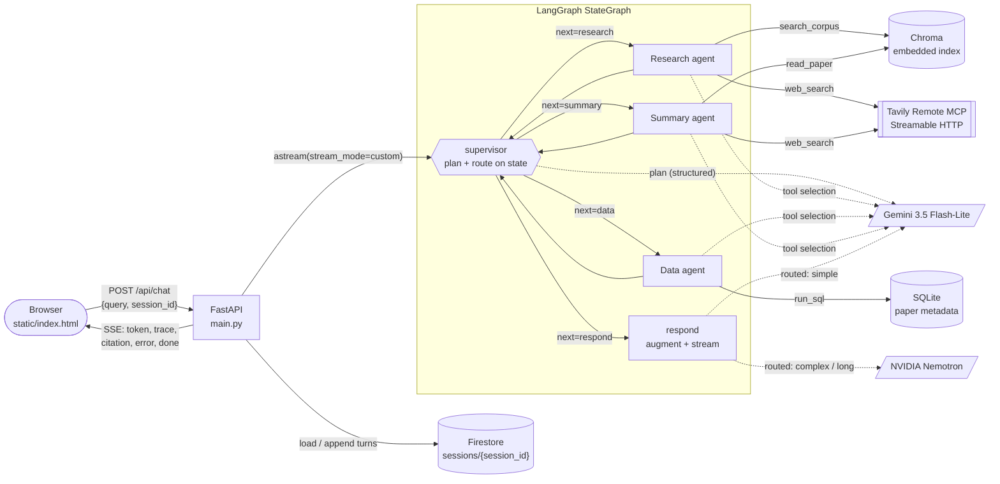

# Architecture

**Paper Agents** is a multi-agent research assistant over a corpus of 50 arXiv papers on LLM agents and retrieval-augmented generation. A LangGraph **supervisor** delegates each question to three specialized agents. Answer generation is routed between **two LLM providers** (Google Gemini and NVIDIA NIM). Live web knowledge comes from **Tavily Remote MCP**, shared by two agents. Answers stream to a vanilla HTML/JS page over **Server-Sent Events**, with the routing decision, the orchestration trace and the citations visible on every turn. Conversation history is stored in **Firestore**, so it survives Cloud Run instance replacement.

## 1. Orchestration graph

Pattern: **Supervisor** (LangGraph `StateGraph`, `src/graph/graph.py`). Rendered copy of the diagram: [`architecture.png`](architecture.png).



**Control flow per turn**
1. `supervisor`, first visit: the routed LLM returns a structured `Plan` (`agents`, `complexity`, `reason`). The plan is validated (only known agents, no repeats, at most 3).
2. `supervisor`, every visit: it picks `next` **only from state fields** (`plan`, `completed`, `failed`, `steps`), then emits an `agent_route` trace event with the reason and a snapshot of those fields. The conditional edge reads `state["next"]`. No transition is hard-coded.
3. Workers run, append their notes and citations, and return to the supervisor.
4. When no planned worker remains, or the step guard (`MAX_WORKER_STEPS=4`) is hit, the supervisor sends control to `respond`. That node augments the prompt with numbered sources and streams the answer from the routed provider.

**Failure handling** (`make_worker` in `src/graph/graph.py`)
- Every worker runs inside `try/except`. On error it returns `{"failed": [{agent, error}]}` instead of raising. The supervisor reads `failed`, skips that agent, continues with the rest of the plan, and says so in the trace (`"research failed -> continuing with remaining plan"`).
- If **all** planned workers fail, `respond` still runs and tells the user which part could not be completed.
- LLM calls fall back to the other provider on any error (`router.invoke` / `router.stream`). Streaming only falls back before the first token, so the user never sees two half-answers.
- If the planner LLM fails on both providers, a keyword `heuristic_plan` keeps the graph answering.
- Tool errors (e.g. invalid SQL) go back to the agent's LLM for one corrective round.
- Test hook: `debug_fail_agent` in the request body, or `?fail=research` in the UI URL, forces a worker to raise. This is used in `tests/test_graph.py::test_worker_failure_does_not_crash_graph` and in the smoke test against the live URL.

### State schema (`src/graph/state.py`)

| Field | Type | Written by | Purpose |
|---|---|---|---|
| `session_id` | str | API | Firestore document key |
| `query` | str | API | current user question |
| `history` | list[{role, content}] | API (from Firestore) | prior turns, used for follow-ups |
| `force_fail` | str \| None | API | test hook for failure handling |
| `plan` | list[str] \| None | supervisor | ordered workers chosen by the planner LLM |
| `complexity` | "simple" \| "complex" | supervisor | input to the LLM router |
| `plan_reason` | str | supervisor | planner's one-sentence rationale |
| `next` | str | supervisor | the routing field read by the conditional edge |
| `steps` | int | workers | loop guard |
| `completed` | list[str] (append) | workers | finished workers |
| `failed` | list[{agent, error}] (append) | workers | failed workers |
| `notes` | list[{agent, text}] (append) | workers | tool summaries / SQL rows for the answer prompt |
| `citations` | list[dict] (append) | workers | corpus chunks and web results |
| `answer` | str | respond | final streamed text |

Append-only fields use `Annotated[list, operator.add]` reducers, so workers can never overwrite each other's output.

## 2. Agents: responsibilities, tools, prompts, models

Specialization is by **distinct tool access and distinct system prompts** (`src/agents/tools.py::AGENT_TOOLS`, `src/agents/prompts.py`). An agent can only execute its own tools: `tools.execute` rejects anything else.

| Agent | Responsibility | Tools (exclusive unless noted) | System prompt focus | Model / provider |
|---|---|---|---|---|
| **Supervisor** (not counted) | Plan which workers to run, route between them | none | Worker catalogue, plan rules, complexity rubric | Gemini 3.5 Flash-Lite (structured output) |
| **Research** | Grounded answers about methods/results, plus current events | `search_corpus` (Chroma top-k), `web_search` (Tavily MCP, **shared**) | Gather evidence only, never answer from memory, use the web for anything after 2024 | Gemini 3.5 Flash-Lite for tool selection |
| **Data** | Counting / listing / ranking over paper metadata | `run_sql` (read-only SQLite) | Full table schema, SQL rules, fix the query on error | Gemini 3.5 Flash-Lite for tool selection |
| **Summary** | Faithful summary of one named paper, plus follow-up work | `read_paper` (ordered chunks of one paper), `web_search` (Tavily MCP, **shared**) | Always load the paper, search the web for impact/follow-ups | Gemini 3.5 Flash-Lite for tool selection |
| **respond** (answer writer) | Augmented generation with citations | none | Citation rules (see §4) | **Routed**: Gemini 3.5 Flash-Lite or NVIDIA Nemotron 3 Ultra |

Worker LLM calls only select tools and arguments. After tools run, the worker returns its evidence directly instead of making a second "summarize" LLM call. That saves one call per worker. The single answer is written by `respond`.

## 3. LLM routing (`src/llm/router.py`)

Providers: **Google** `gemini-3.5-flash-lite` and **NVIDIA NIM** `nvidia/nemotron-3-ultra-550b-a55b` (exact IDs in `.env.example`, verified on 2026-10-26 with `scripts/check_models.py`; `gemini-3.8-flash` and `3.7-flash` returned 503 on the free tier that day). Routing dimension: **hybrid (cost + capability)**. `router.decide()` is a pure function and is unit-tested in `tests/test_graph.py::test_router_decisions_are_pure_and_documented`.

| Role | Condition (state signal) | Provider → model | Dimension | Why |
|---|---|---|---|---|
| supervisor plan | always | Gemini Flash-Lite | cost | Short JSON classification; the cheapest, fastest model with reliable structured output |
| worker tool selection | always | Gemini Flash-Lite | cost | Short function-calling step; Flash-Lite has native function calling |
| respond | `complexity == "complex"` | NVIDIA Nemotron | capability | Multi-step reasoning or a comparison across papers |
| respond | `n_sources >= 2` (two or more workers' results) | NVIDIA Nemotron | capability | Integrating evidence from different agents |
| respond | `context_chars > 8000` (e.g. a full-paper summary) | NVIDIA Nemotron | capability | Long-context synthesis |
| respond | none of the above | Gemini Flash-Lite | cost | Single-source short answer |
| any | chosen provider's key missing | the other provider | availability | Keeps the service up |
| any | Gemini model returns 429 / 503 (quota, overload) | next Gemini model in `GEMINI_FALLBACK_MODELS` (`gemini-3.6-flash`, `gemini-3.5-flash`) | same dimension | Each model has its own free-tier quota, so the provider choice is kept; the exhausted model is skipped for 60 s |
| any | all Gemini models exhausted, or any other error | the other provider | fallback | Keeps answering; traced with the error |

Every decision is emitted as an `llm_route` trace event with `provider`, `model`, `dimension`, `reason` and the `signals` that drove it. The UI shows these in the **Routing** tab for every turn, so a grader can see why each provider handled each step without reading code. The smoke test checks that the `respond` step used **both** providers across a normal query mix.

## 4. RAG pipeline

| Stage | Implementation |
|---|---|
| **Corpus** | 50 arXiv papers (2017-2024) on RAG, dense retrieval, reasoning, tool use, agents, multi-agent systems, benchmarks, foundation models and alignment. Fetched by `scripts/fetch_corpus.py`, which checks each ID against an expected title keyword. Full text extracted with `pypdf`, bibliography removed. Stored as `data/corpus/<arxiv_id>.txt`, metadata in `data/papers.json` |
| **Ingestion** (`src/rag/ingest.py`) | `RecursiveCharacterTextSplitter`, **chunk_size 1200 chars, overlap 200**, separators `\n\n` → `\n` → `. ` → space, sentence-final periods kept with their sentence, fragments < 80 chars dropped. Chunk id = `<arxiv_id>#c<n>` |
| **Embeddings** | Local `sentence-transformers` `BAAI/bge-small-en-v1.5` (384-d, normalized; BGE query instruction prefix on queries only) |
| **Storage** | Embedded **Chroma** `PersistentClient`, cosine space, built inside the Docker image from the committed corpus text, so the index never comes from a laptop |
| **Retrieval** (`src/rag/retriever.py`) | top-**k = 5** by cosine similarity. The Summary agent instead loads the first 8 chunks of one paper in reading order |
| **Augmentation** | Up to 12 deduplicated sources are numbered `[1]..[n]` with title, year, arXiv ID and chunk ID, plus each agent's notes and the last 16 messages (8 question/answer pairs) of conversation |
| **Generation** | LCEL chain `RunnableLambda(state → inputs) \| ChatPromptTemplate \| routed LLM`, streamed token by token |
| **Citations** | Each `[n]` maps to a `citation` SSE event carrying `arxiv_id`, chunk `id`, `url` (arxiv.org/abs/…) and a snippet. The UI links `[n]` in the answer to the source card |

Why 1200/200: about 250-300 tokens per chunk keeps a method description or a results paragraph together, five chunks fit easily in the prompt, and the overlap keeps sentences that straddle a boundary retrievable from either side.

**Augmentation prompt template** (`ANSWER_PROMPT`):

```text
[system]
You are the answer writer for a multi-agent research assistant over a corpus of arXiv papers on LLM
agents and retrieval-augmented generation.
Rules:
1. Answer ONLY from the numbered sources and agent notes below. If they do not contain the answer, say so.
2. Cite every factual sentence with its source number in square brackets, e.g. [1] or [2][4]. Never
   invent a source number. Corpus sources are papers; web sources are live search results.
3. Keep paper names and arXiv IDs exactly as given.
4. Be concise: 1-3 short paragraphs or a short list, unless the user asks for more.
[human]
Conversation so far:
{history}

Agent notes:
{notes}

Sources:
[1] <title> (<year>), arXiv:<id>, chunk <arxiv_id#cN>
<chunk text>
[2] WEB: <title> - <url>
<snippet>
...

User question: {question}

Write the answer now. Citation format is mandatory: put the source number in square brackets right
after each factual sentence, e.g. "Self-RAG trains the model to emit reflection tokens [2]." Use only
numbers that appear under Sources. If Sources says "(no sources retrieved)", answer from the agent
notes without brackets.
```

The closing reminder was added after the first live smoke test: Nemotron Ultra followed the system-prompt citation rule inconsistently, while a rule repeated immediately before generation was followed every time (19/19 checks afterwards).

Evaluation: RAGAS (faithfulness, answer relevancy, context precision, context recall) over the fixed 15-question set in `src/eval/questions.json`. Results are in `docs/evaluation.md`.

## 5. MCP tool sharing between agents (criterion 6)

Path chosen: **MCP tool sharing** (not A2A).

- **Server:** Tavily Remote MCP at `https://mcp.tavily.com/mcp/?tavilyApiKey=<key>` (Streamable HTTP, key in the query string, no local MCP process, no OAuth), connected with `langchain-mcp-adapters` `MultiServerMCPClient` at startup (`src/tools/tavily_mcp.py`).
- **Sharing:** one client and one discovered `tavily_search` tool serve **two agents** through the same `web_search` wrapper:
  - **Research agent:** current events and anything newer than the corpus ("latest developments in agentic RAG this month").
  - **Summary agent:** follow-up work and current impact of the paper being summarized ("ReAct follow-up work").
- **Inspectability:** every call emits an `mcp_tool_call` trace event with the calling agent (`node`), server, MCP tool name, query, latency and result URLs. Web results become `web` citations.
- **Rationale:** live retrieval is a capability both agents need for different reasons. One shared MCP connection avoids duplicated connection setup and per-agent API keys, and it keeps one place to handle quota and errors. The wrapper exposes a minimal `{query}` schema so both providers' function-calling handle it reliably, while the call itself goes through the MCP tool.
- **Degradation:** missing key or unreachable server → `/health` reports it, agents get "web_search unavailable", and corpus answers still work.

## 6. Durable state (Firestore)

The app claims multi-turn memory, so it persists conversation state **outside process memory** (`src/state_store.py`).

- **Store:** Firestore (Native mode), collection `sessions`, one document per `session_id`:
  `{created, updated, turns: [{role, content, ts, meta: {plan, providers}}]}` (last 40 turns kept).
- **Per turn:** the API loads the document → passes `history` into graph state → after the answer streams, appends the user + assistant turns. The graph itself is stateless per turn, so any Cloud Run instance can serve any session (scale-out safe), and a new instance after recycling or redeploy reads the same history.
- **Why not a LangGraph checkpointer:** what must survive is the conversation, not the mid-turn graph state. A turn completes within a single request, so checkpointing intermediate nodes would add writes without adding durability that matters.
- **Local dev:** `STATE_BACKEND=memory` is a process dict, labeled "not durable" in `/health` and the trace. It is never claimed as persistence.
- **Proof:** see `docs/evaluation.md` §Durability. The test asks a question, forces a new instance (new revision), confirms `/health` shows a different `instance_id`, then asks "what was my first question?" on the same session. The UI also restores the session's history from Firestore on page load.
- **Access:** the Cloud Run runtime service account gets `roles/datastore.user` (`deploy.sh`). No credentials are stored in the image.

## 7. Streaming contract (SSE)

`POST /api/chat` with `{query, session_id, debug_fail_agent?}` → `text/event-stream`. The browser reads it with `fetch()` + `ReadableStream`, because native `EventSource` cannot POST.

| event | data |
|---|---|
| `trace` | `{kind, node, t, ...}`: kinds `request`, `history_loaded`, `plan`, `agent_route`, `llm_route`, `agent_start`, `agent_end`, `rag_retrieval`, `paper_read`, `sql_query`, `mcp_tool_call`, `worker_error`, `respond_done` |
| `citation` | `{n, kind: corpus\|web, id, arxiv_id, title, year, url, agent, score, snippet}` |
| `token` | `{text}`: answer tokens as the provider streams them |
| `error` | `{message, node}` |
| `done` | `{plan, providers, timings_ms: {total, ttft, llm, retrieval, tools}, usage, cost_usd, instance_id}` |

Other routes: `GET /` (UI), `GET /static/*`, `GET /health` (index, MCP, store, providers, instance id), `GET /api/history`, `POST /api/reset`.

## 8. Deployment shape

A single Cloud Run service built from a multi-stage `python:3.13-slim` Dockerfile. The build stage installs CPU-only torch plus the pinned requirements, downloads the embedding model and **builds the Chroma index and SQLite DB from `data/corpus`**. The runtime stage runs as a non-root `appuser`, with HuggingFace in offline mode, `uvicorn main:app` bound to `$PORT`, and the static frontend served by FastAPI.
Settings: 2 GiB / 1 vCPU, `--cpu-boost`, concurrency 10, timeout 300 s, min 0 / max 3 instances. Secrets are passed with `--set-env-vars` from the local `.env` by `deploy.sh`, never committed or baked into the image.
